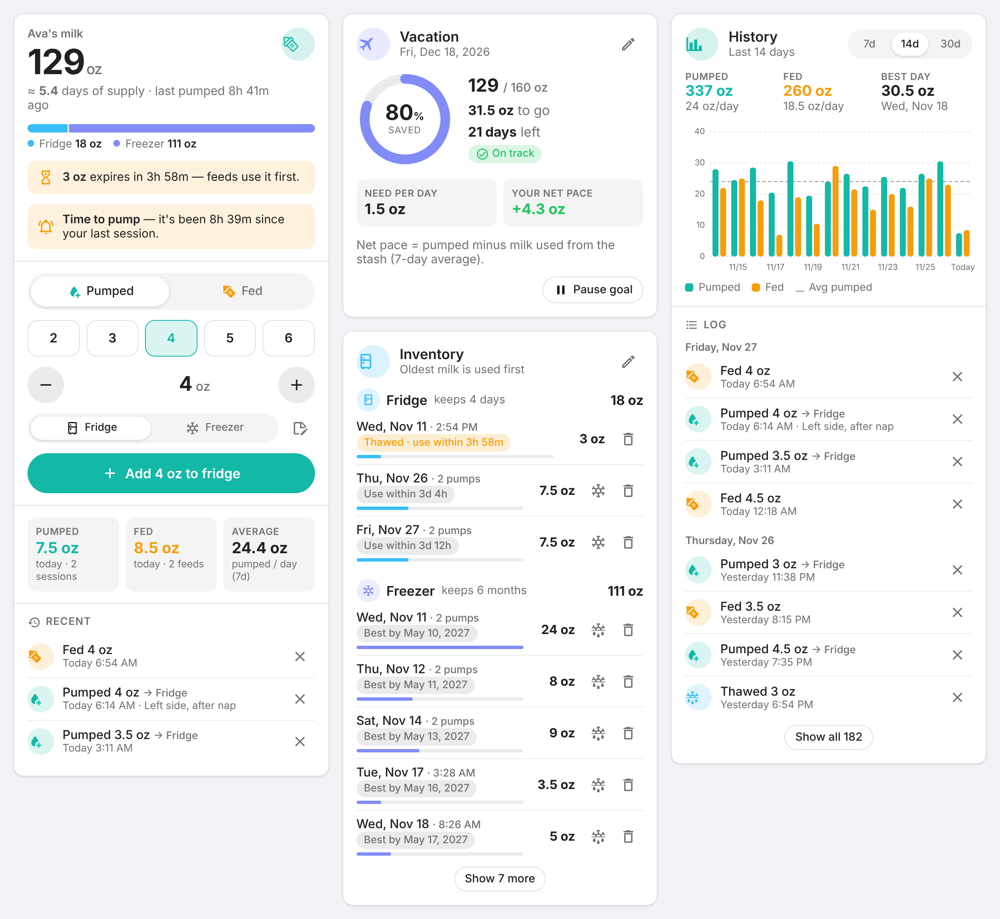
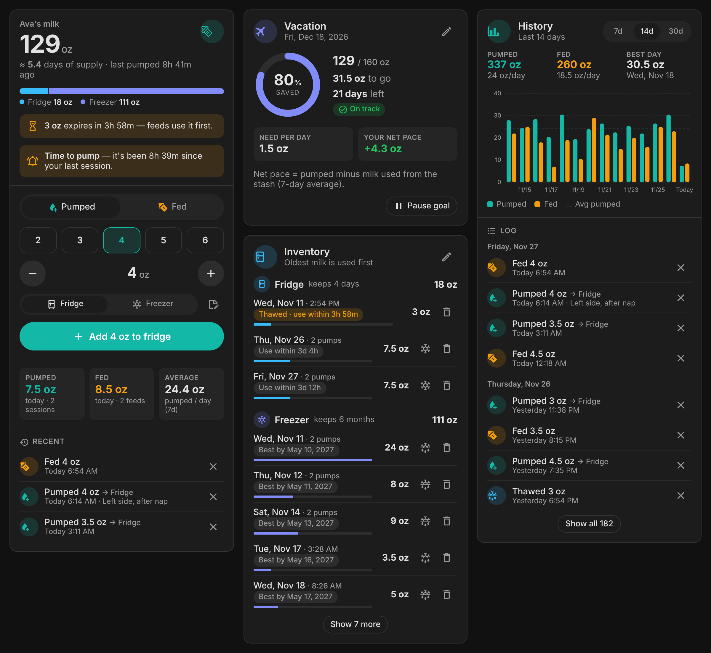

# 🍼 Milk Tracker for Home Assistant

> **Beta.** This is an early release. Please [open an issue](https://github.com/highergroundstudio/HA-Milk-Tracker/issues) if something doesn't work. Keep a note of your stash amounts in case you need to correct them.

Track your pumped breast milk stash — what's in the fridge and freezer, what's
about to expire, how much you pump and feed each day, and whether you're on
pace for a stash goal (a trip, going back to work…).

It's a proper integration: one setup wizard, no helpers, scripts, template
sensors or midnight-reset automations, and it comes with four custom
dashboard cards.

[](https://www.home-assistant.io)
[](https://hacs.xyz/docs/faq/custom_repositories/)
[](https://github.com/highergroundstudio/HA-Milk-Tracker/releases)
[](https://github.com/highergroundstudio/HA-Milk-Tracker/actions/workflows/validate.yml)
[](LICENSE)



<details><summary>Dark mode</summary>


</details>

[](https://my.home-assistant.io/redirect/hacs_repository/?owner=highergroundstudio&repository=HA-Milk-Tracker&category=integration)

## Features

- **Fridge & freezer tracking.** Each pump session is stored as its own batch, and feeds use the oldest milk first.
- **Expiry tracking.** Based on CDC guidance: 4 days in the fridge, 6 months in the freezer, and 24 h after thawing. All three are configurable. A sensor and a card banner warn you before milk expires.
- **Freezer-only mode.** If all your milk goes straight into the freezer, turn the fridge off and the cards hide it.
- **Date milk you already have.** Enter existing bags with the date they were pumped. The amount comes out of your undated starting stash, so the total doesn't change but you get real best-by dates.
- **Log after the fact.** Pick an earlier time when logging a pump or feed.
- **Freeze & thaw.** Move milk between fridge and freezer with one tap. Thawed milk gets a 24-hour use-by time.
- **Undo anything.** Every log entry can be removed, not just the last one, and the stash is restored exactly. Each card action shows a toast with an **Undo** button.
- **Daily stats without a midnight reset.** Today's totals, 7-day averages and a 30-day history are all calculated from the log.
- **Days of supply.** Uses a fixed daily intake, or *automatic* mode, which learns it from the feeds you log.
- **Stash goal.** Shows progress, amount still needed, needed-per-day versus your actual net pace, and an on-track or behind projection.
- **Pump reminder.** A binary sensor turns on when it's been too long since your last session.
- **Twins / multiple babies.** Add the integration once per baby.
- **Automation-friendly.** Every action is a service, and each one fires a `milk_tracker_logged` event.

## Installation

### HACS (recommended)
1. HACS → ⋮ → *Custom repositories* → add `https://github.com/highergroundstudio/HA-Milk-Tracker`, category **Integration**.
2. Install **Milk Tracker** and restart Home Assistant. While it's in beta, you may need to turn on *Show beta versions* for this repository in HACS (⋮ → *Redownload*).
3. *Settings → Devices & services → Add integration → Milk Tracker*.

### Manual
Copy `custom_components/milk_tracker` into your `config/custom_components/` folder and restart.

The cards are bundled with the integration and **load automatically**, so you don't need to add a resource or install a separate frontend plugin.

### Updating

- **Card-only updates** (release notes say *No restart needed*): update in HACS, then refresh the page.
- **Integration updates:** update in HACS and restart Home Assistant. Home Assistant only loads integration code at startup. Until you restart, the main card shows a "Restart Home Assistant to finish" notice.

## Migrating from the helper-based setup

1. Note your current `input_number.milk_stash` value (plus anything else you want to carry over, e.g. goal amount/date).
2. Add the integration. On the second step, enter your stash. Split it between fridge and freezer if you can.
3. Paste [`examples/dashboard.yaml`](examples/dashboard.yaml) into your dashboard's raw configuration editor.
4. Set the goal from the goal card.
5. Once you're happy, delete the old helpers, the `script.milk_add` / `script.milk_use` scripts, the template sensors and the midnight-reset automation.

## Cards

All cards have a visual editor. If you only have one tracker, `entry_id` is optional.

| Card | What it does |
|---|---|
| `custom:milk-tracker-card` | Stash total, a fridge/freezer split bar and alert banners (expiring, pump due). Pumped/Fed toggle with quick-amount chips, stepper, location picker and an optional note. Today's stats and recent entries. |
| `custom:milk-tracker-goal-card` | Progress ring with needed/day vs your net pace and an on-track projection. Set or edit the goal inline. |
| `custom:milk-tracker-inventory-card` | Batches grouped by day for fridge and freezer, each with a use-by countdown. Freeze, thaw and discard each group, discard all expired milk, or correct the totals after counting your bags. |
| `custom:milk-tracker-history-card` | Pumped vs fed bar chart over 7/14/30 days (tap a day for details) and the full log grouped by day. |

Main card options:

```yaml
type: custom:milk-tracker-card
title: Ava's milk
quick_amounts: [2, 3, 4, 5, 6]
one_tap: false       # true = chips log immediately (good for wall tablets)
default_mode: pump   # or feed
show_today: true
show_recent: 3       # 0 hides the list
```

Colors follow your theme. You can override them with these theme variables:
`milk-tracker-pump-color`, `milk-tracker-feed-color`,
`milk-tracker-fridge-color`, `milk-tracker-freezer-color`.

## Entities

| Entity | Notes |
|---|---|
| `sensor.*_stash`, `*_fridge`, `*_freezer` | Long-term statistics enabled |
| `sensor.*_pumped_today`, `*_fed_today` | Session/feed counts as attributes |
| `sensor.*_pumped_last_7_days`, `*_average_pumped_per_day`, `*_average_fed_per_day` | |
| `sensor.*_days_of_supply` | |
| `sensor.*_last_pumped`, `*_last_fed`, `*_next_expiry` | Timestamps |
| `sensor.*_goal_progress`, `*_goal_remaining`, `*_goal_needed_per_day`, `*_days_until_goal` | Unavailable while the goal is off |
| `binary_sensor.*_pump_due`, `*_milk_expiring` | For notifications |
| `switch.*_goal_tracking`, `number.*_goal_amount`, `date.*_goal_date`, `number.*_daily_intake` | Settings |
| `button.*_undo_last_entry`, `*_discard_expired_milk` | |

## Services

| Service | Fields |
|---|---|
| `milk_tracker.log_pump` | `amount`, `location` (fridge/freezer), `timestamp`, `duration_minutes`, `note` |
| `milk_tracker.log_feed` | `amount`, `source` (auto/fridge/freezer), `timestamp`, `note` |
| `milk_tracker.add_stored` | `amount`, `pumped_at` (date or date+time), `location`, `replace_undated` (default true), `note` |
| `milk_tracker.move` | `amount` or `batch_id`, `source`, `destination` |
| `milk_tracker.discard` | `amount` + `source`, or `batch_id`; `note` |
| `milk_tracker.discard_expired` | |
| `milk_tracker.set_stash` | `fridge`, `freezer` |
| `milk_tracker.configure` | `goal_active`, `goal_amount`, `goal_date`, `goal_name`, `daily_intake` |
| `milk_tracker.undo` / `delete_entry` | `entry_id` for delete |

All services accept an optional `config_entry_id` (needed only with multiple
trackers) and return the new log entry plus a summary as a response.

See [`examples/automations.yaml`](examples/automations.yaml) for a pump reminder with
an actionable "Log 4 oz" notification, an expiry warning, and a physical-button logger.

## Options

*Settings → Devices & services → Milk Tracker → Configure*: use the fridge
(on/off), where new milk goes by default (freezer unless changed), intake mode
(fixed/automatic), pump reminder interval, fridge and freezer shelf life, and
the expiry warning window.

## Development

```bash
pip install pytest-homeassistant-custom-component home-assistant-frontend
pytest
```

The stash model is in `tracker.py` and has no Home Assistant dependency.
The cards are a single dependency-free JS file in `frontend/`.

> Food-safety defaults follow CDC guidance for healthy, full-term babies.
> Ask your pediatrician if your situation is different.

## License

[MIT](LICENSE)
